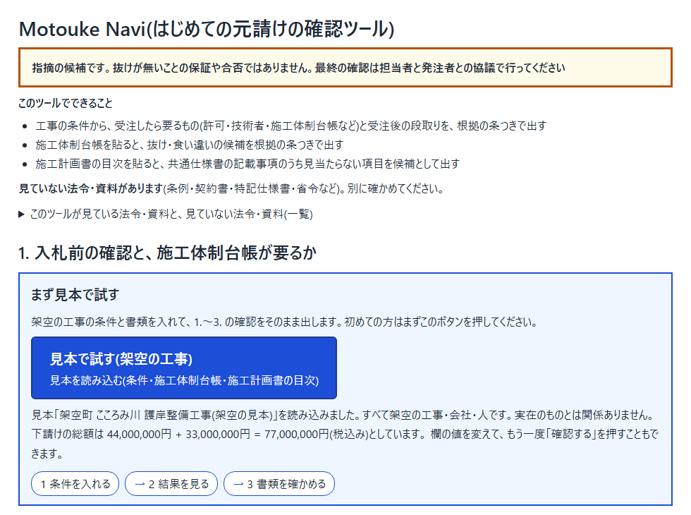
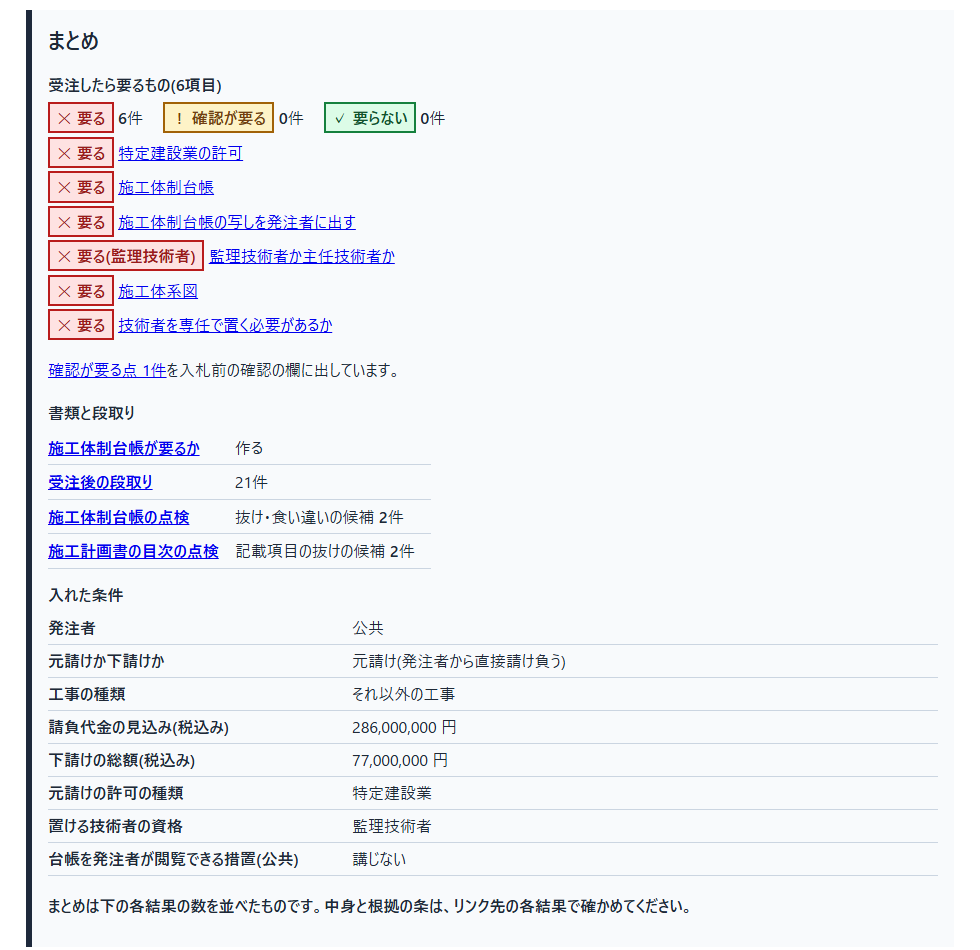

# Motouke Navi(はじめての元請けの確認ツール)
経験、ノウハウがないからこそ一から調べてやらなければならない<br>多くの経験がない若手や元請けを請けたことがない建設業に届いてほしい。<br>道具を使うことで若手に任せられるものが増えて、若手の教育を効率化できる。<br><br>

最初の3文は作者の言葉です。作者は建設の現場で働く1年目で、作者のいる部署は、いま初めて元請けに取り組もうとしています。大会のあと最初に使うのは、その仕事で、作者と身近にいる経験のある人です(入札の前と受注したあと)。3文目は作者の考えで、測った結果ではありません。

- 誰の: 多くの経験がない若手と、元請けを請けたことがない建設業の確認の仕事
- どんな場面で: 「この金額なら特定建設業の許可が要るか」「施工体制台帳は要るか、写しは出すのか」「監理技術者か主任技術者か、専任か」を、そのたびに建設業法・施行令・入契法と国交省の資料を引いて確かめている。受注のあとは、共通仕様書のどの条で、いつ・何を・誰に出すのかを、着手から引き渡しまで追う
- 何を: 入札前の確認・施工体制台帳の要否・受注後の段取り(着手から完成・引き渡しまで)・書類の点検の候補を、法令と国の仕様書の原文の抜き書きつきで出す
- どう: 使う前は法令と発注者の仕様書を自分で引いて確かめる必要があった元請けの確認を、使うと工事の条件を入れるだけで、読むべき原文の抜き書きつきの候補として見られます

元請けとしての決まりは建設業法などの法令と発注者の仕様書に分かれています。手がかりになる国の作成例は、国の直轄工事のものだけです。(テーマ #2「本来、誰にでも届くべきものを。」)

この道具は、その場面で法令と国の共通仕様書のどこを読めばよいかを、原文の抜き書きつきで示します。既定の段取りと記載項目は国の例ですが、県の仕様書から Skill `spec-to-rules` で行を作り、画面の「自分の発注者の表を読み込む」で国の例の代わりに使えます(和歌山県の仕様書の7つの節で1件試しました)。読み込まないときと、行にしていない部分の発注者の仕様書との照らし合わせは担当者が行います。

> Built with Claude: Japan 2026 の期間中(2026-11-02 から)に作りました。開始前に用意した開発の仕組み(自走キット)と設計・受け入れ条件の文書は、主催者の案内に従ってリポジトリの外に置いた。このリポジトリには期間中に書いたものだけが入っている。受け入れ条件の文書と自走の仕組みは開始前に用意し、受け入れテストのコードと作品は期間中に書きました(大会のキックオフは 2026-11-02 12:00〜12:30、作品の最初のコミットは同じ日の 20:48、受け入れテストのコードは同じ日の 21:18 のコミットで、コミットの日時は `git log` で見られます)。プロジェクト概要は [docs/overview.md](docs/overview.md)、3分の動画の台本は [docs/demo-script.md](docs/demo-script.md)、各機能の細かい説明と限界は [docs/manual.md](docs/manual.md) にあります。

## 5分で試せる手順
Web の画面は、開いたあとは通信しません。Claude を使う部品(`tools/claude-check.mjs`・`plugin/`)は、使う人自身の API の鍵か Claude Code のログインで動き、費用もその人の契約にかかります(`claude plugin eval` の費用と時間の目安は、2026-11-05 に E1 の古い組(検査9つ)を あり・なし 各3回で走らせた値の 約 $3.70・1042秒です。今は E2 のケースが増え、`refuter` と `check_articles` も動くので、それより増える見込みです(未測)。詳しくは docs/評価.md §7)。作者の鍵はこのリポジトリに入っていません。

審査のときなどに、短い時間で全体を触るための順番です。1〜3 はブラウザだけで済みます(インストールは要りません。1 の Pages はページを読み込む通信だけで、開いたあとは通信しません)。
画面は次のとおりです。1枚目は開いた直後の最初の画面、2枚目は「まず見本で試す」→「この内容で結果を見る」と進んだあとの結果の先頭で、写っているのは架空の見本の工事だけです。





1. GitHub Pages の URL `[Pages の URL]`(提出の前に作者が入れます)をブラウザ(Edge・Chrome・Firefox など)で開く。または、リポジトリの `index.html` をブラウザで開く(1分)
2. 入口の「まず見本で試す」を押す。架空の工事の条件が入り、確かめの画面で「この内容で結果を見る」を押すと、入札前の確認・施工体制台帳が要るか・受注後の段取りが根拠の条つきで出ます。見本の台帳と目次の点検の候補は「次へ: 3 書類を確かめる」の先の「2.」「3.」に出ます。上の「1 条件を入れる」を押して請負代金を変え、「確認する」→「この内容で結果を見る」と進むと、結果の変わり方が見られます(2分)
   - 公告から拾った条件も読み込めます。入口の「公告から拾った条件を読み込む」で `docs/samples/bid-intake/画面に入れる条件.json`(架空の公告から拾った見本)を選ぶと欄に値が入り、「確認する」を押すと、値の出どころと公告の抜き書きを確かめる画面が開きます
3. 下の折りたたみ「ここからは別の道具」を開き、「A. 文の置き換え」で、架空の人名(例 `甲野 一郎`)を「辞書に足す」で人名として足し、`現場代理人 甲野 一郎 / 架空建設株式会社 / kono@example.com` のような文を貼って「置き換える」を押す。〔人名1〕〔会社名1〕のような記号に置き換わり、「元に戻す」で戻せます(1分)
4. Claude Code があれば、プラグインで評価のケースを点検する(1分〜。動かす人の Claude の使用量がかかります)
   - 空の作業フォルダを、このリポジトリの `plugin/` の外に作り、`plugin/evals/cases/E1_しおかぜ町下水道/raw/` だけを写す(`case.json` は写さない)
   - その作業フォルダで `claude --plugin-dir <このリポジトリ>/plugin` を開き、`case.json` の `prompt` を渡す。`raw/` の書類は直接は読めず、道具 `read_masked` で置き換えた後の中身だけが渡ります
   - 返ってきた指摘をファイルに保存し、`node plugin/evals/score.mjs plugin/evals/cases/E1_しおかぜ町下水道 <答えのファイル>` で採点する
   - 公式の評価で走らせるときは、リポジトリの直下で次の1行です。`<固定の値>` は走らせるモデルに、`<別の固定の値>` は判定役のモデルに置き換えます。判定役は作る側(`--model`)と別のモデルに固定します。`--scaffold` が無いと書類が作業フォルダへ写らず、`--allow-real-servers` と `--allow-tools` の4つの道具が無いと本物の MCP の道具が使えません。`--no-publish` が無いと報告が claude.ai へ公開されます。E1・E2・E4 が走り、1つだけなら `--case e1-trace-masked` のように足します

     ```
     claude plugin eval plugin --model <固定の値> --judge-model <別の固定の値> --scaffold --allow-real-servers --allow-tools mcp__plugin_motouke-navi-guard_masked-files__read_masked mcp__plugin_motouke-navi-guard_masked-files__list_masked mcp__plugin_motouke-navi-guard_masked-files__check_articles mcp__plugin_motouke-navi-guard_masked-files__check_conditions --ablation with-without --runs 3 --no-publish --output-dir tmp/eval --report tmp/eval/report.html
     ```

   - E4(仕込みの無い書類で言い切らないか)も走ります。`plugin/evals/E4-no-planted/` の架空の台帳1冊で、答えが法令違反を言い切らず、候補・確認・判断できないの形で書くかを見る退行の評価です。E4 だけなら命令の `--ablation with-without` を外して `--case e4-no-planted --ablation none` を付けます。E4 は未測です(`docs/評価.md` の 7)

## できること
- 多くの経験がない若手や、元請けを請けたことがない建設会社が、入札の前と受注の後に「何が要るか」「書類に抜けが無いか」を、建設業法などの条文と国の共通仕様書を引きながら確かめる手間を減らします
- 工事の条件(公共・民間、請負代金、下請けの総額、許可の種類など)を入れると、受注したら要るもの(特定建設業の許可・施工体制台帳・監理技術者・施工体系図など)と、受注後の段取りの一覧を、根拠の条と原文の抜き書きつきで出します
- 施工体制台帳と施工計画書の目次を貼ると、抜け・食い違いの候補を根拠つきで出します。施工体系図も貼ると、下請負人の一覧・技術者の氏名・発注者の名前を台帳と突き合わせます。外の AI に貼る前に、人名・会社名などを記号に置き換える部品もあります

## デモ
- 動画: (提出のときに作者が URL を書きます。台本は `docs/demo-script.md`。12場面・2:58 で、実在の公告1件を読むところから結果、架空の書類の点検、測った数字までを1本で見せます。期間中に作った機能だけを映します)

## 業界の構造にどう効くか(効かないことも含めて)
国の直轄の一般土木工事では、D等級に登録した 9,734 社のうち、2016 年以降に単体の元請けで受注したのは 723 社です(国土交通省「中小建設業への普及促進方策について」p.2。北海道と沖縄を除く)。この数を、国の直轄の工事を元請けで受けた経験を社内で積む機会は限られている、と読みました(残る会社が県や市町村の工事で元請けをしている可能性は、この資料からは分かりません)。この道具が手伝うのはその調べ方で、受注そのもの(実績・等級・資金)は変えません。

建設業の就業者は 685万人(平成9年)から 477万人(令和6年)に減り、生産労働者の賃金は年 443万円(全産業は年 527万円)、労働時間は年 1,987時間(全産業は年 1,939時間)です(賃金は令和6年、労働時間は令和6年度。国土交通省の参考資料1「改正の背景」)。中央建設業審議会の「労務費に関する基準」は、多重的な下請契約等の下で、労務費が技能者を雇用する建設業者まで適正に確保されづらいと書いています。

令和6年の法改正(令和6年法律第49号)は、ここに新しい定めを入れました。建設業者には労働者の処遇の確保が努力義務になり(建設業法 第25条の27)、適正な労務費等に比べ著しく低い労務費等による見積りや見積り変更の依頼は禁止になりました(第20条第2項・第6項)。元請けは下請けとの関係では注文者にあたるので(第2条第5項)、元請けになることは、管理の責務に加えて、労務費を確保して渡す側の定めを引き受けることでもあります。

この道具が手伝えるのは、初めて元請けの責務(施工体制台帳、技術者の配置、労務費と処遇、安全の措置)を引き受けるときに、法令と国の資料のどこを読めばよいかを、原文の抜き書きつきで示すことだけです。労務費の定めは、入札前の確認の結果の節「労務費と処遇の確認(確認が要る候補)」に、第20条第6項と第25条の27第2項の抜き書きつきで出します。第20条第6項は下請けに出す場合に出し、元請けのときと、下請けがさらに下請けに出すときで文を分けています。下請けに出さないなら出しません。第25条の27第2項はどちらの立場でも出します。当たる・当たらないは判定しません。

国が ICT 施工について中小建設企業5社(C・D等級)に聞いた結果では、5社のうち4社が ICT 建機を内製化し、外注では社内にノウハウ・知見が残らないことが理由に挙がっています(「中小建設業への普及促進方策について」。令和7年12月1日の委員会の資料)。これは ICT 施工の話で、この道具について調べた結果ではありません。この道具が目指す向きは、各社がばらばらに調べ直す手間を、法令と国の資料の共通の参照に置き換えることです。

効かないこと:

- 受注: 実績・等級・資金・人の体力は変えません。公告が元請けの施工実績を求めていれば抜き書きつきで知らせますが、入札に参加できるかは判断しません
- 価格: 価格の競争が強まるか弱まるかは測っていません。入札の額の良し悪しも、労務費が著しく低いかどうかも判定しません
- 建設会社の数: 数を動かす仕組みはありません
- 使う人の選別: 1枚の HTML で、通信も保存もしないので、誰が使うかは選べません。技術者の配置や施工体制台帳のように体制が無ければ満たせない条件を結果に出すだけです
- 安全の実務: 労働安全衛生法の候補は、取り込んだ一部の条から出す候補です。現場の安全の管理そのものは道具の外で、その水準が上がるかは測っていません
- 浮いた時間の使い道: 処遇や育成に回るかどうかは道具では決められず、測ってもいません

## しくみ
- 原文の取得: 建設業法・施行令・入契法・労働安全衛生法などの条は e-Gov 法令 API から、国交省の資料は公開ページから取り、`data/sources/` に置く(下の「データと出典」)
- 規則表: 条件と結論と根拠の抜き書きを1行にした表(`data/rules.json`・`data/schedule.json`・`data/plan-items.json`・`data/safety.json`・`data/quotes.json`)。抜き書きは原文と機械で照らし(`scripts/check-quotes.mjs`)、合わない行は使わない。金額の境目もコードに書かず、抜き書きの文から読む
- 判定と点検: 画面の入力 → 規則表 → 入札前の確認・台帳が要るか・段取りの一覧・安全の法令の候補・台帳と目次の点検の候補。決められないことや選んでいない欄があるときは「判断できない」に出し、足りない欄の名前を挙げる。推測で埋めない
- 画面: `index.html` ひとつ。外部と通信せず、入れた内容を保存しない。印刷と CSV の書き出しができる

## 開き方
- リポジトリの `index.html` を、ブラウザ(Edge・Chrome・Firefox など)で開くだけです(ファイルをダブルクリックするか、ブラウザの窓にドラッグする)。サーバーやインストールは要りません
- 画面は外部と通信しません。入れた内容はブラウザにも保存しません(ページを閉じると消えます)
- スマホ(iPhone・Android)でファイルのまま開いて動くかは、まだ実機で確かめていません。
- `index.html` は `node build.mjs` で `src/` から組み立て直せます(Node.js 22 以降。画面を使うだけなら要りません)

## 試し方
1. `index.html` を開き、入口の「まず見本で試す」(見本を読み込むボタン)を押す。架空の工事(架空町 こころみ川 護岸整備工事)の条件が入力欄に入り、入れた条件を行で確かめる画面が開きます。「この内容で結果を見る」を押すと、「入札前の確認」と「施工体制台帳が要るか」が根拠の条つきで出ます。結果の一番上の数字のカードと「次にすること」から、詳しい結果と根拠の条へ移れます
2. 「見本の書類(架空)を見る」を開くと、見本の施工体制台帳と施工計画書の目次が見られます。それぞれ「2.」「3.」の欄に入り、点検の候補がそのまま出ます
3. 入力欄の値を変えて「確認する」を押し直すと、入れた条件を行で確かめたあと、結果がどう変わるか試せます
4. 「PDF で保存・印刷」で要点のまとめを、「全部を印刷する」で根拠の条文や段取りまでを、「結果を CSV に書き出す」で CSV を、最後に確認した結果から紙やファイルに出せます

見本の工事・会社・人・番号はすべて架空です。

## 機能ごとの要点(詳しくは docs/manual.md)
- [受注後の段取り](docs/manual.md#受注後の段取り着手から完成引き渡しまで): 「着手まで」「施工中」「完成・引き渡し」の段に分けて、いつ・何を・誰に・根拠(土木工事共通仕様書(案)令和8年3月の箇所と抜き書き)を出します。国の直轄の例で、段に分けたのはこのツールの整理です。工種を変えると表と出典が切り替わります(読めた範囲は「限界」の節)。工事目的物そのものの引き渡し(契約書によるもの)は入れていません
- [施工体制台帳の点検](docs/manual.md#施工体制台帳の点検): 下請けの記載・技術者の氏名と資格の空、監理技術者・特定建設業・専任の要否の食い違いの候補と、施行規則 第14条の2 第1項の記載事項の表を出します。国交省の作成例の Excel(.xlsx)からも6つの欄を読みます(請負代金額の欄は様式に無い)。候補は合否ではありません
- [施工計画書の目次の点検](docs/manual.md#施工計画書の目次の点検): 共通仕様書 1-1-1-6 の記載事項16項目のうち、目次の見出しに見当たらない項目を候補に出します。比べるのは見出しの言葉だけです
- [Claude で点検](docs/manual.md#claude-で点検手元のプログラム): 手元の `tools/claude-check.mjs` が、置き換えた後のファイルだけを、送る中身を全部見せてから「送る」と打ったときだけ1回送ります。送り先は `https://api.anthropic.com/v1/messages` だけです。AI の候補は法令の判定とは別の欄に出します。[画面なしの Claude Code で動かす版](docs/manual.md#claude-で点検画面なしの-claude-code)もあります(鍵ではなくログインで動きます。架空の書類で走らせた記録は同じ節にあります。最新は 2026-11-05 です)

## 文の置き換え(外のサービスに貼る前に)
画面の「A. 文の置き換え」で、人名・会社名・現場名・住所・電話・メール・許可番号を〔人名1〕のような記号に置き換え、外の AI から戻った文を「元に戻す」で戻せます。.txt・.docx・.xlsx からも読みます(この端末の中で読み、外へ送りません)。手順・人名と現場名の規則・限界の数字は [docs/manual.md の「文の置き換え」](docs/manual.md#文の置き換え外のサービスに貼る前に) にあります。
- 置き換えには漏れがあります。漏れは0になりません。辞書に無い人名・現場名などは残ることがあります。初めて見る架空の書類4件では、辞書に足さないと漏れの率は 37.8%、人名・現場名を足すと 14.3% でした(`docs/mask-rate.md`。2026-11-04 朝に commit 520ced6 で、作る側ではない別の担当が測った数字で、そのあとの置き換えの直し(F31・F36)では測り直していません。この4件は作る側は見ていません。直す前は 58.2% でした)。外へ出す前に必ず目で確かめてください
- 記号にしても、残った語の組み合わせ(工期・金額・地名・工種・発注者など)から、どの工事か・誰のことかが分かるおそれがあります
- 書き出した対応表と辞書のファイルには元の名前が入っています。外へ送らないでください
- 会社・団体の名前は業界を問わない規則で置き換えます。法人の種類(株式会社・一般社団法人・社会福祉法人・税理士法人 など)とその略し方(「(株)」「（一社）」)・囲み文字(「㈱」「㊑」「㍿」。NFKC で正規化して拾う)、法人格の前後の空白1字、ひらがな・カタカナの入る名前(「みほん建設株式会社」)、法人格の無い団体・施設(「〇〇工務店」「〇〇幼稚園」「〇〇町役場」。確信の弱い語として印を付ける)です。語の一覧と出典は `src/mask/company-types.mjs`、規則は `src/mask/rules-company.mjs`、細部と限界は docs/manual.md の「文の置き換え」にあります
- 住所も業界を問わない規則で置き換えます。〒と郵便番号、都道府県を書かない住所(「みほん市さくら町1-2-3」)、空白で区切った住所、丁目・番地・号の最後まで(漢数字・全角・ハイフンの揺れも)、建物名・部屋番号です。住所は番地(か建物名・部屋番号)で終わり、続く会社名・人名・電話を食いません。都道府県と市区町村だけ(「架空県みほん市」)は発注者の名前とみなし、住所の欄名の後ろのときだけ置き換えます。規則と出典は `src/mask/rules-address.mjs`、細部と限界は docs/manual.md の「文の置き換え」にあります
- 置き換えるたびに、架空の人名・会社名・住所を、この道具が扱う型で6語、見つけにくい型(文脈の無い姓名・番地の無い住所・表の中の名前など)で6語、型を毎回選び直して見えない所で混ぜ、「見つけやすい型 6/6・見つけにくい型 1/6」のように分けて画面とプラグインの道具 `read_masked` の結果に出します。見つけにくい型の結果は漏れの目安で、保証ではありません。残った見本があれば型と語を出して注意します。混ぜた語は後の欄・対応表・記号の番号に入れません。空港の手荷物検査で、検査の画面に偽の危険物の画像を時々混ぜて見落としを測るやり方から借りました。見本の型はこの道具が扱う形から選んでいるので、全部置き換わっても、ほかの形の名前が残っていないことは示しません(部品 `src/mask/decoy.mjs`)
- 置き換えるたび・確かめてほしい語の選びを変えるたび・「元に戻す」を押すたびに、対応表の元の語が後の欄に残っていないかを、全角・半角、空白、ハイフン、英字の大文字・小文字の違いをそろえて探し直し、「元に戻す前の点検」として残りの数と場所を出します。「残す」を選んだ語と1字の語は数えません。探すのは対応表にある語だけなので、対応表に無い名前の漏れは見つけません(部品 `src/mask/residual.mjs`)
- 業界の切り替えで「医療(例)」を選ぶと、表 `src/mask/suffix-medical.mjs` で施設名・医療の役職の後ろの人名を置き換えます。語尾の表を差し替えれば別の業界でも使えることを示す「例」です。医療の書類での漏れの率は測っていません

## Claude Code に組み込む
`raw/` に置いた生のファイル(元の名前が入ったもの)を Claude Code の道具で読む操作の多くを止め、置き換えた後の中身だけを渡すための設定と道具です(`integration/claude-code/`)。詳しくは [docs/manual.md の「Claude Code に組み込む」](docs/manual.md#claude-code-に組み込む)。
- フック `hooks/guard-raw.mjs` が Read・Grep・Glob・Bash などで `raw/` を読む形を止め、手元の MCP の道具 `masked-files` の `read_masked` が置き換えた後の中身だけを返します
- `read_masked` は UTF-8(BOM の有無どちらも)と Shift_JIS のファイルを読みます。Excel の既定で保存した CSV・TXT は Shift_JIS になることがあります。どちらでも読めないファイルは、中身を返さず読めない旨を返します。ISO-2022-JP のファイルは、そのまま読むと名前が置き換わらないので読む前に断ります。空のファイルも断ります
- 画面の「辞書を書き出す」で保存した辞書のファイルを環境変数 `MASK_DICT` に指定すると、`read_masked` も辞書に足した語(人名・現場名など)を置き換えます。読めない辞書は理由の種類だけを返して断り、辞書の語は道具の返事・出力に出しません
- `list_masked` は `raw/` の中のファイル名を置き換えずに返すので、ファイル名に人名・会社名などの個人情報が入っているとそのまま送られます。個人情報を含まない名前にしてください
- コマンド(`cat` など)での読み取りは、Linux・WSL で Claude Code の sandbox が有効なときは止まります。Windows(ネイティブ)では sandbox が使えないので止まりません。フックで止めきれない操作もあります

## Claude Code のプラグイン(plugin/)
上の守り(フック)と道具を、作業フォルダに写さずに使えるようにしたプラグインです。建設の書類を点検する Skill(`skills/construction-check/`)、発注者の仕様書の文から段取りと施工計画書の記載項目の行を作って原文と機械で照らす Skill(`skills/spec-to-rules/`。[説明](docs/manual.md#claude-code-のプラグインplugin))と、指摘の候補を崩しにかかる反証の係(`agents/refuter.md`)が入っています。`claude --plugin-dir ./plugin` で、そのセッションだけ読み込めます。
- 公告・入札説明書・仕様書から条件を拾う Skill `bid-intake`: 値ごとに原文の抜き書きを付け、MCP の道具 `check_conditions`(部品は `check-conditions.mjs`)が原文と合わない値を外し、単位・桁・前後の食い違いを「確かめが要る」にします。原文は道具が読み、読めるのは作業フォルダの中で `raw/`・`secrets/`・`.claude/`・`.git/` の下と名前が `.` で始まる部分の外だけで、名前に `:` のあるパスと Windows のデバイス名(`CON` など)のパスも断ります。人が読む表と、段1 の「公告から拾った条件を読み込む」で開くファイルを出します。見本は [docs/samples/bid-intake/拾った結果.md](docs/samples/bid-intake/拾った結果.md)(架空の公告)
- 数量の表から参考の額を出す Skill `estimate`: 金抜き設計書や数量総括表の行を Claude が施工パッケージに当て、両方の抜き書きを付けます。`check-estimate.mjs` が抜き書きと単位を照らし、合わない行は合計に入れず、通った行だけをプログラムで積み上げます。1行ごとの出どころ、合計に入っていない行の割合、補正していない部分の額と割合を参考の額と並べます。見本は [docs/samples/estimate/結果.md](docs/samples/estimate/結果.md)(架空の数量の表と架空の単価)
- 辞書は、端末で環境変数 `MASK_DICT` に辞書のファイルのパスを入れてから `claude --plugin-dir ./plugin` で開くと使えます(`plugin/.mcp.json` の `env` が `"MASK_DICT": "${MASK_DICT:-}"` を道具へ渡します)。入れないと空が渡り、辞書なしで動きます。確かめたのは2つに分けてです。同じ書き方の使い捨てのプラグインで、Claude Code 2.1.317 が値と空を道具へ渡すことを `claude mcp list` で確かめ(2026-11-04)、道具が辞書の語を置き換えることは単体の試験で確かめました。このプラグインで Claude に `read_masked` を呼ばせて、辞書の語が置き換わるところまで通しては確かめていません
- プラグインは `permissions.deny` と sandbox の設定を配れません。コマンドでの読み取りを sandbox で止めるには、`integration/claude-code/.claude/settings.json` を作業フォルダに置いてください
- Skill `construction-check` が根拠にできるのは、Skill に入れた8つの条だけです(`plugin/skills/construction-check/reference/sources/` の `law-*.txt` の数)。作品全体で取得した法令の条は29です(`data/sources/index.json` の `kind` が `law` の行の数。2026-11-06 に数えた)。残る21の条は画面の判定・安全の法令の候補・工種の種目に使っていて、この Skill の根拠にはできません。条番号の確かめは、その条・項・号が取得した原文にあるかだけを見ます
- 部品・試した記録・限界の全部は [docs/manual.md の「Claude Code のプラグイン」](docs/manual.md#claude-code-のプラグインplugin)

## Claude Code での作り方
開発の仕組み(自走キット・hook・subagent・機能の一覧)は開始前に作ったもので、このリポジトリには入っていません(審査の対象外です)。Claude Code が1つずつの機能を短いセッションで作り、人は決めることがあるときだけ答える形で作りました。受け入れテスト(`tests/acceptance/`、21 ファイル)は人の承認のあと指紋で固定し、作る係は直せません。仕組みの説明は [docs/manual.md の「Claude Code での作り方」](docs/manual.md#claude-code-での作り方) にあります。作品の中で Claude と機械が役を分けている筋と、期間中に作った跡の数は、[docs/overview.md の「Claude の使い方」](docs/overview.md#claude-の使い方) にあります。

## 評価
- 確かめた数字: 架空の見本の書類3件に仕込んだ抜けと誤り11件のうち見つけたのは9件(2026-11-04 の採点。版 7ba4f4f、1fcb4ec の出力も同じ。9件のうち1件は部分一致で、見落としが2件)、和歌山県の仕様書の7つの節から作った31行のうち抜き書きが原文と合ったのは31行(「土木請負工事必携」令和7年11月版、check-rows。行の意味は人が確かめます)。
- 仕込みの出力の確かめ: 2026-11-06 に版 7ba4f4f と版 7055986 で `node scripts/run-fixtures.mjs` を回して比べ、工事3件(A・B・C)の出力は1字も違いませんでした(違いは、中身の無い `fixtures/bid-intake` の行が1つ増えたことだけ)。採点のし直しはしておらず、仕込み表も使っていません。
- 受け入れテスト 21 ファイル・110 件がすべて通る(`node --test tests/acceptance/*.test.mjs`)。単体の試験は `tests/unit/` にあり、`node --test tests/unit/*.test.mjs` で回します
- 規則表の抜き書き 345 件が原文にある(`node scripts/quote-rate.mjs`。2026-11-06 に回した数)
- 仕込みの評価: 架空の書類3件(`fixtures/`)の仕込み 11 件のうち見つけた 9・見落とし 2・言い過ぎ 0(2026-11-04 14時の採点。見つけたの数は 2026-11-03 が 5、2026-11-04 10時が 7。`docs/評価.md`)。採点した出力の版は 7ba4f4f で、書類どうしの突き合わせ(F32a)が入っています。見つけた 9 件のうち 1 件は、仕込みの欄の一部だけを指摘した部分一致です。2 件は見落としています。仕込み表と置き換えの正解の表はリポジトリに入れていません。公告の拾いの正解(架空の公告 N1〜N5)は `docs/samples/bid-intake/測り/正解/` に、初めて見る書類は `fixtures/unseen/` に入っています。`answers.json`・`score/`・岡山労働局の公告を文にしたファイルとその正解は入れていません
- 県の仕様書で試した結果: 和歌山県の仕様書の7つの節で Skill `spec-to-rules` が作った行 31 のうち、照合で残った 31・外した 0・判断できない欄のある行 7。機械が確かめたのは抜き書きが原文のその節にあることと形だけで、意味の正しさは人が確かめます。試したのは1件だけです(`docs/評価.md` の [6](docs/評価.md#6-県の仕様書で試した結果f26c))
- プラグインの評価のケース(`plugin/evals/`): 2ケース × あり・なし × 3回を走らせ、見落としは あり 5/30(すべて止まった1回)・なし 0/30 でした。止まった1回のほかは、どちらも0です。根拠の正しさの数え方はプラグインの側に有利で、回数も少ないので良し悪しは言い切れません。走らせ方と限界は [docs/manual.md の「評価」](docs/manual.md#評価)
- 公式の評価 `claude plugin eval`: 古い組(検査9つ)の値で、書類の元の名前8つのうち Claude に渡らなかったのは、あり 8・なし 0(各3回。2026-11-05 に、部署名のあとの人名の漏れを直した版で走らせ直した値)。古い組の判定は合格です。直す前の 11/4 の版では、あり 7・なし 0 で、渡ったのは「丁山」でした。答えの語の組と手順の印を足した新しい組と E2 のケースは未測です(`docs/評価.md` の [7](docs/評価.md#7-公式の評価のケースe1-の名前がやりとりの記録に出ないか))

## データと出典
取得のしかた・抜き書きの範囲・加工の中身は [docs/manual.md の「データと出典の細部」](docs/manual.md#データと出典の細部) にあります。

| 資料 | URL | 取得日 |
|---|---|---|
| 建設業法(第3条・第24条の8・第26条。e-Gov 法令 API) | https://laws.e-gov.go.jp/law/324AC0000000100 | 2026-11-02 |
| 建設業法(第2条・第20条・第25条の27。労務費と処遇の確認の根拠。e-Gov 法令 API) | https://laws.e-gov.go.jp/law/324AC0000000100 | 2026-11-06 |
| 建設業法施行令(第2条・第7条の4・第27条) | https://laws.e-gov.go.jp/law/331CO0000000273 | 2026-11-02 |
| 公共工事の入札及び契約の適正化の促進に関する法律(第15条) | https://laws.e-gov.go.jp/law/412AC0000000127 | 2026-11-02 |
| 建設業法施行令(第37条。工種の欄の7種目の根拠) | https://laws.e-gov.go.jp/law/331CO0000000273 | 2026-11-06 |
| 建設業法施行令(第15条・第28条・第30条。専任の確認の根拠) | https://laws.e-gov.go.jp/law/331CO0000000273 | 2026-11-06 |
| 建設業法施行規則(第14条の2) | https://laws.e-gov.go.jp/law/324M50004000014 | 2026-11-03 |
| 労働安全衛生法(第14条・第15条・第15条の2・第16条・第29条・第29条の2・第30条・第88条) | https://laws.e-gov.go.jp/law/347AC0000000057 | 2026-11-05 |
| 労働安全衛生法施行令(第6条・第7条) | https://laws.e-gov.go.jp/law/347CO0000000318 | 2026-11-05 |
| 労働安全衛生規則(第18条の2の2・第89条・第90条・第634条の2) | https://laws.e-gov.go.jp/law/347M50002000032 | 2026-11-05 |
| 国土交通省「建設業許可事務ガイドライン」(44ページの一節だけを写した) | https://www.mlit.go.jp/totikensangyo/const/content/001860019.pdf | 2026-11-02 |
| 国土交通省「監理技術者制度運用マニュアル」最終改正 令和7年1月28日(9ページの一節だけを写した) | https://www.mlit.go.jp/totikensangyo/const/content/001859191.pdf | 2026-11-06 |
| 国土交通省「土木工事共通仕様書(案)令和8年3月」(第1編 第1章 第1節の14の条の文だけを写した) | https://www.mlit.go.jp/tec/r08dobokukoujikyoutsuusiyousyo/honbun01_syo01_setsu01.html | 2026-11-02 |
| 国土交通省 大臣官房官庁営繕部「公共建築工事標準仕様書(建築工事編)令和7年版」(１章 各章共通事項だけを PDF から機械で写した。`scripts/fetch-kenchiku-spec.mjs`) | https://www.mlit.go.jp/gobuild/content/001888816.pdf | 2026-11-05 |
| 国土交通省 大臣官房官庁営繕部「公共建築工事標準仕様書(電気設備工事編)令和7年版」(第1編 第1章 一般事項だけを PDF から機械で写した。`scripts/fetch-setsubi-spec.mjs`) | https://www.mlit.go.jp/gobuild/content/001888825.pdf | 2026-11-06 |
| 国土交通省 大臣官房官庁営繕部「公共建築工事標準仕様書(機械設備工事編)令和7年版(修補版)」(第1編 第1章 一般事項だけを PDF から機械で写した。`scripts/fetch-setsubi-spec.mjs`) | https://www.mlit.go.jp/gobuild/content/001967513.pdf | 2026-11-06 |
| 国土交通省 大臣官房技術調査課 電気通信室「電気通信設備工事共通仕様書 令和8年版」(第1編 第1章 総則だけを PDF から機械で写した。`scripts/fetch-tsushin-park-spec.mjs`) | https://www.mlit.go.jp/tec/it/denki/gijyutukijyun/R0803kouji.pdf | 2026-11-06 |
| 国土交通省 都市局 公園緑地・景観課「公園緑地工事共通仕様書 令和6年5月」(表紙と目次の頁だけを PDF から機械で写した。本文は入れていない。`scripts/fetch-tsushin-park-spec.mjs`) | https://www.mlit.go.jp/toshi/park/content/001742862.pdf | 2026-11-06 |
| 岡山労働局「入札公告 新見労働基準監督署屋上防水及び内壁等改修工事」(令和8年7月14日。拾いの正しさの測りにだけ使った。文はリポジトリに入れていない) | https://jsite.mhlw.go.jp/okayama-roudoukyoku/content/contents/002731806.pdf | 2026-11-06 |
| 林野庁(森林管理局の工事の公告。地域は伏せた)「【簡易型運用版】施工体制確認型 入札公告 〔地名は伏せた〕治山工事(一般競争入札・政府調達対象外)」(令和8年10月21日。拾いの正しさの測りに使った。文はリポジトリに入れていない) | (URL は伏せた) | 2026-11-06 |
| 国土交通省「土木工事工事費積算要領及び基準の運用」国官技第455号(共通仮設費率・現場管理費率・一般管理費等率の別表と端数処理の頁だけを写した) | https://www.mlit.go.jp/tec/content/001987206.pdf | 2026-11-05 |
| 国土交通省 大臣官房官庁営繕部「公共建築工事共通費積算基準(令和8年改定)」令和8年3月11日 最終改定 国営積第15号(全文を PDF から機械で写し、別表の式・係数・範囲を機械で読んだ。`scripts/fetch-kyotsuhi.mjs`) | https://www.mlit.go.jp/gobuild/content/001733141.pdf | 2026-11-06 |
| 国土交通省「令和8年度 施工パッケージ型積算方式 標準単価表」国技建管第16号(補正式を使う。表はリポジトリに入れず、使う人の手元で取る) | https://www.mlit.go.jp/tec/content/001989802.pdf | 2026-11-05 |
| 国土交通省「令和8年3月から適用する公共工事設計労務単価について」(使う人の手元で取る) | https://www.mlit.go.jp/report/press/content/001981942.pdf | 2026-11-05 |
| 国土交通省 九州地方整備局「予定価格(税抜き)の積算内訳(工事)」本局 令和8年度(道具の額のずれを測るのに使った。ファイルはリポジトリに入れない。使った6件の URL は docs/評価.md の9節) | https://www.qsr.mlit.go.jp/nyusatu_joho/sekisan-uchiwake-koji/R8/20/2000.html | 2026-11-05 |
| 国土交通省「令和7年3月から適用する公共工事設計労務単価について」(標準単価の基準年月の東京の単価に使う。使う人の手元で取る) | https://www.mlit.go.jp/report/press/content/001864366.pdf | 2026-11-05 |
| 国土交通省「施工体制台帳(作成例)」(Excel の様式を手を加えずに同梱) | https://www.mlit.go.jp/totikensangyo/const/content/001389106.xlsx | 2026-11-02 |
| 国土交通省「施工体制台帳等のチェックリスト」(題名・URL・取得日だけを画面に出す。写していない) | https://www.mlit.go.jp/totikensangyo/const/content/001389105.docx | 2026-11-03 |
| 和歌山県「土木請負工事必携(令和7年11月)」第1編 第1章 1-1-1-6〜12(試した文 `fixtures/specs/wakayama_r0711_1-1-1-6_12.txt` と、見本の行 `data/specs/wakayama_r0711_rows.json` の抜き書きと言い換え。和歌山県ホームページ公開情報利用規約 https://www.pref.wakayama.lg.jp/prefg/000200/opendata/hpopendatakiyaku.html 、CC BY 4.0 と互換)。和歌山県「土木請負工事必携(令和7年11月)」を加工して作成。この出力は和歌山県が作成したものではありません | https://www.pref.wakayama.lg.jp/prefg/081100/hikkei/k-hikkei-r0711/20251115.html | 2026-11-04 |
| 国土交通省「参考資料1 改正の背景」ほか(令和7年12月施行の改正の説明資料。業界の構造の節の就業者・賃金・労働時間の数と、発注者から下請までの図。読むのに使い、ファイルはリポジトリに入れない) | https://www.mlit.go.jp/totikensangyo/const/content/001971681.pdf | 2026-11-06 |
| 中央建設業審議会「労務費に関する基準」(令和7年12月2日決定。業界の構造の節の説明に使い、ファイルはリポジトリに入れない) | https://www.mlit.go.jp/tochi_fudousan_kensetsugyo/const/content/001971712.pdf | 2026-11-06 |
| 国土交通省 不動産・建設経済局建設業課「第三次・担い手3法について」(令和6年8月。令和6年法律第49号の概要に使い、ファイルはリポジトリに入れない) | https://www.mlit.go.jp/tochi_fudousan_kensetsugyo/const/content/001760946.pdf | 2026-11-06 |
| 国土交通省「中小建設業への普及促進方策について」資料-2(中小建設企業5社のヒアリング結果に使い、p.2 の 723社 / 9,734社 にも使う。ファイルはリポジトリに入れない) | https://www.mlit.go.jp/tec/constplan/content/001984988.pdf | 2026-11-06 |
| Anthropic「API and data retention」 | https://platform.claude.com/docs/en/manage-claude/api-and-data-retention | 2026-11-02 |
| Anthropic「How long do you store my organization's data?」 | https://privacy.claude.com/en/articles/7996866-how-long-do-you-store-my-organization-s-data | 2026-11-02 |
| Anthropic「Is my data used for model training?」 | https://privacy.claude.com/en/articles/7996868-is-my-data-used-for-model-training | 2026-11-02 |
| Claude Code の文書(plugins/manifest-reference・plugins/create・plugins/components・hooks・sub-agents) | https://code.claude.com/docs/en/plugins/manifest-reference.md ほか4ページ | 2026-11-03 |
| Claude Code の文書(mcp。道具の返事の保存と上限。開いたのは設計の係で、作る係は開いていない) | https://code.claude.com/docs/en/mcp | 2026-11-06 |
| Claude Code の文書(plugins-reference・hooks。hooks の既定の置き場と、Skill の frontmatter の hook を登録する時。開いたのは設計の係で、作る係は開いていない) | https://code.claude.com/docs/en/plugins-reference ・ https://code.claude.com/docs/en/hooks | 2026-11-06 |
| Claude Code の文書(plugin-evals。`--case` を付けないときに走るケース、`partial`・`skippedPaidGraders`、`arm: with-only` の検査の点の扱い。開いたのは設計の係で、作る係は開いていない) | https://code.claude.com/docs/en/plugin-evals | 2026-11-06 |
| Anthropic の記事 Demystifying evals for AI agents(評価のケースの数の始めの目安、pass@k と pass^k、退行の評価と能力の評価。開いたのは調べる係で、作る係は開いていない) | https://www.anthropic.com/engineering/demystifying-evals-for-ai-agents | 2026-11-06 |
| デジタル庁デザインシステム `@digital-go-jp/design-tokens`(MIT。画面の色の値の多くを借りた。この画面はデジタル庁が作ったものではない) | https://www.npmjs.com/package/@digital-go-jp/design-tokens | 2026-11-05 |

- 会社・団体の名前の語の一覧(`src/mask/company-types.mjs`)は、国税庁「法人種別」(https://www.houjin-bangou.nta.go.jp/documents/k-resource-dl-ver4.pdf)・法務局「商業・法人登記の申請書様式」(https://houmukyoku.moj.go.jp/homu/COMMERCE_11-1.html)・Unicode の文字表(https://www.unicode.org/Public/18.0.0/charts/PDF/U3200.pdf)・学校教育法 第1条・医療法 第1条の5・老人福祉法 第5条の3・介護保険法 第8条(e-Gov の URL はファイルに書いた)の語を、作る係とは別の進行役が並べた一覧(2026-11-03)から入れました。開発用のエージェントはこれらのページを開いておらず、原文と照合していません。略し方と慣用の語尾は公式の一覧が無いので「慣用」として分けています
- 住所の規則(`src/mask/rules-address.mjs`)の並び(〒・都道府県・市区町村・町字・丁目・番地・号・建物名)は、デジタル庁「アドレス・ベース・レジストリ」(https://www.digital.go.jp/policies/base_registry_address)・日本郵便「郵便番号データの説明」(https://www.post.japanpost.jp/service/search/zipcode/download/readme.html)を、都道府県の名前は総務省「全国地方公共団体コード」(https://www.soumu.go.jp/denshijiti/code.html)を出典として、作る係とは別の進行役が並べた一覧(2026-11-03)から入れました。開発用のエージェントはこれらのページを開いておらず、原文と照合していません。建物名の語尾と「市区町村ではない語」は慣用です
- 国交省の資料は、公共データ利用規約(第1.0版)(PDL1.0)に従って利用します(資料に権利表記が無いので、国土交通省ウェブサイト利用規約 https://www.mlit.go.jp/links/terms-of-use.html による)。抜き出し・言い換えはこの作品の作者(開発用のエージェントを含む)が行ったもので、このツールの出力は国土交通省が作成したものではありません
- 岡山労働局の入札公告は、岡山労働局ウェブサイトの利用規約(https://jsite.mhlw.go.jp/okayama-roudoukyoku/link_chosakuken_menseki.html)により公共データ利用規約(第1.0版)(PDL1.0)で利用します。作者が PDF を pdftotext で文にし、氏名と電話の番号を伏せ、拾った値の数を数えました(加工の主体: Motouke Navi の作者)。docs/評価.md の数は作者が作ったもので、岡山労働局が作成したものではありません
- 治山工事の入札公告は、森林管理局のウェブサイトの利用規約(地域と URL は伏せた)により公共データ利用規約(第1.0版)(PDL1.0)で利用します。出典:林野庁(森林管理局の工事の公告。地域は伏せた)を加工して作成。作者が PDF を pdftotext で文にし、担当者の連絡先(氏名・電話・メール)を伏せ、拾った値の数を数えました(加工の主体: Motouke Navi の作者)。docs/評価.md の数は作者が作ったもので、森林管理局が作成したものではありません
- 工種の選択(建設業法施行令 第37条の技術検定の7種目。https://www.mlit.go.jp/tochi_fudousan_kensetsugyo/const/tochi_fudousan_kensetsugyo_const_fr1_000001_00025.html)で切り替える表のうち、段取りの行・記載項目・積算の率の表は、国交省の資料をこの作品の作者が加工して作ったものです。加工の主体は作者で、国が作ったものではありません。利用条件は上と同じ PDL1.0 です
- 建築の段取りの行と目次の点検の語(`data/schedule-kenchiku.json`・`data/plan-items-kenchiku.json`)は、公共建築工事標準仕様書(建築工事編)令和7年版の１章を作者が加工して作ったものです。資料の1ページが案内する国土交通省の利用ルール(https://www.mlit.go.jp/link.html)により、公共データ利用規約(第1.0版)(PDL1.0)で利用します。加工の主体は作者で、国土交通省が作ったものではありません
- 電気工事・管工事の段取りの行と目次の点検の語(`data/schedule-denki.json`・`data/schedule-kan.json`・`data/plan-items-denki.json`・`data/plan-items-kan.json`)は、公共建築工事標準仕様書の電気設備工事編・機械設備工事編の第1編 第1章を作者が加工して作ったものです。資料の1ページが案内する国土交通省の利用ルール(https://www.mlit.go.jp/link.html)により、公共データ利用規約(第1.0版)(PDL1.0)で利用します。加工の主体は作者で、国土交通省が作ったものではありません
- 電気通信工事の段取りの行(`data/schedule-tsushin.json`)は電気通信設備工事共通仕様書の第1編 第1章を、造園の説明(`data/zoen-basis.json`)は公園緑地工事共通仕様書の目次の頁の注を、作者が加工して作ったものです。国土交通省ウェブサイト利用規約(https://www.mlit.go.jp/links/terms-of-use.html)により、公共データ利用規約(第1.0版)(PDL1.0)で利用します。加工の主体は作者で、国土交通省が作ったものではありません
- 建築・電気工事・管工事の共通費の率の表(`data/kyotsuhi-rates.json`)は、公共建築工事共通費積算基準(令和8年改定)の別表を作者が加工して作ったものです。資料の1ページが案内する国土交通省の利用ルール(https://www.mlit.go.jp/link.html)により、公共データ利用規約(第1.0版)(PDL1.0)で利用します。加工の主体は作者で、国土交通省が作ったものではありません
- API に送った内容の扱い: 上の Anthropic の公式ページ(2026-11-02 に確認)によると、既定では学習に使いません。保存されても30日以内に自動で削除されます(例外があり、ページどうしで書き方が違います)。使う前に今の扱いを確かめてください

## 限界
- 出すのは指摘の候補です。抜けが無いことの保証や合否ではありません。最終の確認は担当者と発注者との協議で行ってください
- 発注者の仕様書から Skill `spec-to-rules` で作った行のファイルは、画面の「自分の発注者の表を読み込む」で国の例の代わりに使えます(通信も保存もしません。画面では原文と照らしません)
- 建設業法施行令 第37条の技術検定の7種目のうち仕様書を読めた5種目は、土木・建築・電気工事・管工事・電気通信工事です。読んだのは各仕様書の最初の章の一部の条で、作った段取りの行は順に 21・33・38・41・21 行、すべて `node scripts/check-quotes.mjs` を通りました(2026-11-06)。残る2種目のうち、建設機械施工は専用の仕様書が無いので土木にまとめました。造園は公園緑地工事共通仕様書の表紙と目次の頁の注だけを読み、本文を読んでいないので5種目に数えていません
- 見ていない範囲: 建設業の許可の29業種のうちほかの業種の仕様書、改修の仕様書の本文(建築・電気工事・管工事で読んだのは新営の仕様書)、電気通信工事の共通費、機械の共通費のうち管工事の機械設備工事の別表に当たらないもの(建設機械施工に専用の基準など)です。表の無い部分は「この工種の仕様書は見ていない」と出し、法令の判定・安全の法令の候補・公告の読みは工種を問わず出します
- 既定の段取りと施工計画書の記載項目は、国の直轄の土木工事の例です(画面で和歌山県の例に切り替えられます。県の7つの節だけです)。自治体・民間の工事は、発注者の仕様書・契約書で置き換えてください
- 工種の欄は、土木(建設機械施工を含む)・建築・電気工事・管工事・電気通信工事・造園・その他から選びます。仕様書を読めた5種目のうち、段取り・記載項目・積算の表の3つがそろうのは土木だけです。建築・電気工事・管工事にあるのは、段取りの表と、共通費の式(下の参考の積算額の行)と、施工計画書の目次の点検の3つの語(1.2.2 の「総合施工計画書」「工種別施工計画書」「品質計画」の有無だけ。建築の仕様書に記載事項の列挙は無い。見たのは1章で、1.2.2(3)が挙げる中身は見ていない)です。電気通信工事にあるのは段取りの表だけ(電気通信設備工事共通仕様書 令和8年版の第1編 第1章の一部の条で21行。適用は土木工事に係る電気通信設備工事)で、目次の点検と共通費は見ていません。造園は5種目に数えていませんが、段取りだけ土木の表を当てます。公園緑地工事共通仕様書(令和6年5月)の目次に総則の章が無く、目次の注に土木工事共通仕様書 令和6年度版を本文で引用するときの書き方があるからで、当てたのはこの道具の整理です。土木の表は令和8年3月の版で版が違い、令和6年度版は見ていません。そのことを画面・印刷・CSV に出します。造園の目次の点検と積算、公園緑地工事共通仕様書の本文は見ていません。「その他」と、上に挙げていない表は「この工種の仕様書は見ていない」と出し、土木の表で埋めません。建築の段取りは標準仕様書の１章の一部の条(33行)で、新営の仕様書です。改修の仕様書の本文と、２章以降の各章は見ていません。電気工事の段取りは電気設備工事編の第1編 第1章の一部の条(38行)、管工事の段取りは機械設備工事編の第1編 第1章の一部の条(41行)で、どちらも官庁施設の営繕の基準です。ほかの編と改修工事の仕様書は見ていません。法令の判定・安全の法令の候補・公告の読みは工種を問わず出します
- 規則表にあるのは、取得した条と国交省の資料の箇所だけです。契約約款・自治体の要綱は取り込んでいません。施行規則は第14条の2 だけを、台帳の記載事項の表に使っています
- 法令は改正されます。取得日より後の改正は入っていません。使う前に e-Gov で原文を確かめてください。根拠の抜き書きの近く(画面・印刷・CSV の「版」の列)に、取得日と版(法令は「2025年12月12日施行の改正までの条文」のように e-Gov の版の施行日、国交省の資料は「令和8年3月 の版」のように資料の版の表示)を出します
- 文の置き換えの漏れは0になりません。Claude Code の守りも、`raw/` を読む操作のすべては止められません
- 労働安全衛生法の候補は、取り込んだ一部の条から出す候補です。機械等の設置の届出(法 第88条第1項)、店社安全衛生管理者、問いに挙げた9つのほかの作業主任者の作業、酸素欠乏危険場所の一覧(令 別表第六)は見ていません。法律の専門家の確認は受けていません。ブラウザでの見え方も確かめていません。細部は [docs/manual.md](docs/manual.md#労働安全衛生法の候補) に書いています
- 公告の読み取り(Skill `bid-intake`)は、拾った値の候補を出すものです。機械が見るのは抜き書きの位置、数字と名前の形、決めた食い違いだけで、値の意味が原文に合っているかは見ません。拾いの正しさは、架空の公告5件(75欄のうち誤り1)と実在の公開の公告2件(30欄のうち外れ1。1つの欄で拾った全部の行で判定した数で、欄の最初の1行だけで判定すると外れ3)で測りました([docs/評価.md](docs/評価.md) の8)。実在の公告では架空より外れの割合が高く、2件だけなので率としては読めません。元請けの施工実績を求める文は、語で探して結果の「確認が要る点」に抜き書きつきで出します(言い回しによっては漏れます)。入札に参加できるかの判断はしません
- 参考の積算額(Skill `estimate` と `src/estimate/`)は画面にはつないでいません。建築・電気工事・管工事は公共建築工事共通費積算基準の別表の式で共通費だけを計算します。直接工事費と工期(か月)は人が入れ、施工パッケージは土木の表なので建築系の数量からは積みません。率の範囲の外は「別途」と出し、額を出しません。この基準は官庁施設の営繕の基準で、公表の額と比べた測りはしていません。金額の端数の処理は基準に定めが無いので1円未満の切り捨てだけです。昇降機設備工事の別表は読みましたが使っていません。九州地方整備局の公表の積算内訳と比べた結果は [docs/評価.md](docs/評価.md) の9節です。公表の直接工事費から出す間接費は、地域の補正係数を入れないと 9〜30% 低く出る工事がありました。数量からの直接工事費は、公表の額の 0.5〜4.7% しか積めず(3件)、比べられた 13 種別はすべて公表より低い -11.4%〜-0.5% でした。参考の額としてそのまま使える大きさではありません。機械が見るのは抜き書き・数量・単位の文字だけで、当て方が工事の中身に合っているかは見ません。Skill の見本は架空の表で作り、実物の標準単価表では架空の数量の表の2行で動くことを1回確かめただけです。出るのは公開の資料の式による参考の額で、会社の原価を含みません。機械・材料・市場単価の補正は人が単価を入れるまで空けてあり、歩掛や市場単価で積む工種は合計に入りません。入っていない行の額は出せないので、割合は行の数です
- 各機能の細かい限界は [docs/manual.md](docs/manual.md) の各節に書いています

## ライセンス
- この作品のコードと文書は Apache License 2.0 で公開します。本文はリポジトリの直下の `LICENSE`(https://www.apache.org/licenses/LICENSE-2.0.txt と同じ文)です。著作権者の表示は次の1行です
- Copyright 2026 ぺりたん
- 外の部品(ライブラリ)は同梱していません。.docx・.xlsx の展開はブラウザと Node.js に標準の `DecompressionStream` を使っています
- 同梱した国交省の資料は、公共データ利用規約(第1.0版)(PDL1.0)に従います。同梱した法令の原文は著作権の対象外です。これらの扱いは Apache License 2.0 では変わりません
